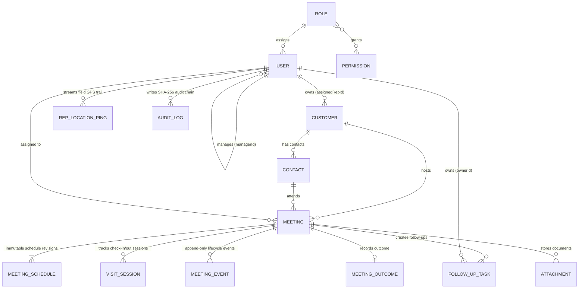

# OPTRONIX — Sales Meeting & Visit Management System

**OPTRONIX** is a full-stack **Sales Meeting & Field Visit Management System** built with **Node.js, Express, TypeScript & MongoDB (Mongoose)** on the backend, **Next.js (React) & Tailwind CSS** on the web frontend, and **React Native (Expo)** for Android field operations.

---

## Project Structure

```text
optronix/
├── backend/                # Express.js + TypeScript + MongoDB REST API & Automated Tests
│   ├── src/
│   │   ├── common/         # ApiError, SHA-256 audit chain, SMTP email, SSE realtime
│   │   ├── config/         # Environment validation & MongoDB transaction helper
│   │   ├── middleware/     # JWT auth, RBAC & Anti-IDOR scoping, CSRF, sanitization
│   │   ├── models/         # 15 Mongoose models (Meeting, VisitSession, MeetingSchedule, etc.)
│   │   ├── modules/        # Modular routes, controllers & domain services
│   │   ├── seed/           # Roles, permissions, demo personas & sample field data
│   │   └── shared/         # Shared Zod schemas, lifecycle state machine & GPS/duration math
│   ├── tests/              # 9 Vitest + Supertest integration & business-rule test suites
│   └── .env.example
│
├── frontend/               # Next.js 15 (React 19) + TypeScript + Tailwind CSS Web App
│   ├── src/
│   │   ├── app/            # Auth flows (/login, /invite) & Workspace screens
│   │   ├── components/     # Minimal SaaS UI components, GeofenceMap & TeamRadarMap
│   │   ├── hooks/          # Session & live SSE context
│   │   ├── lib/            # API client, offline visit queue, MOM PDF & calendar/WhatsApp helpers
│   │   └── shared/         # Shared Zod schemas & domain constants
│   ├── tests/              # Frontend component tests
│   └── .env.example
│
└── optronixapk/            # React Native (Expo SDK 54) Mobile App & Standalone Android APK
    ├── src/                # Mobile screens, native GPS check-in & offline sync
    └── optronix-mobile.apk # Pre-built signed Android release APK
```

---

## 1. Quick Start & Setup Instructions

### Prerequisites
- **Node.js** `>= 20.0.0`
- **pnpm** (or `npm`)
- **MongoDB** (local `mongodb://127.0.0.1:27017/optronix` or MongoDB Atlas URI)

### Step 1 — Configure & Start Backend (`http://localhost:4000`)
```bash
cd backend
cp .env.example .env      # Update MONGODB_URI if using MongoDB Atlas
pnpm install
pnpm seed                 # Seeds roles, permissions, demo users, customers & meetings
pnpm dev
```

### Step 2 — Start Web Frontend (`http://localhost:3000`)
```bash
cd frontend
cp .env.example .env.local
pnpm install
pnpm dev
```

### Demo Accounts (Seeded via `pnpm seed`)
Default password for all seeded accounts: **`Optronix@2026!`**

| Role | Name | Email | Scope |
| :--- | :--- | :--- | :--- |
| **Sales Employee** | Aditya Sharma | `aditya.sharma@optronix.com` | Own meetings, check-in/out, outcomes & follow-ups |
| **Sales Employee** | Rohan Desai | `rohan.desai@optronix.com` | Separate territory (verifies Anti-IDOR isolation) |
| **Sales Manager** | Priya Mehta | `priya.mehta@optronix.com` | North Region team activity, Live Field Radar & governed Reopen |
| **Admin** | Vikramaditya Roy | `vikramaditya.roy@optronix.com` | User invitations, RBAC permissions, settings & SHA-256 audit logs |

---

## 2. Database Model & ER Diagram



### Why Separate Collections Were Chosen
- **`MeetingSchedule` (Immutable Revisions):** Rescheduling appends Revision `#2`, `#3`, etc., without ever overwriting `Meeting.originalScheduledStart` / `originalScheduledEnd`.
- **`VisitSession` (Split-Visit Accuracy):** Each physical check-in/check-out window is its own document with a MongoDB **partial unique index** (`status ∈ ['ACTIVE', 'PAUSED']`) preventing concurrent duplicate check-ins.
- **Design Scenario Verification (`10:02–10:40 AM` + `3:10–4:00 PM`):**
  - Original slot `10:00–11:00 AM` remains intact as `MeetingSchedule` Rev #1.
  - At `10:40 AM`, rescheduling closes `VisitSession #1` (**`38 min`**) and appends `MeetingSchedule` Rev #2 (`3:00–4:00 PM`).
  - Returning `3:10–4:00 PM` records `VisitSession #2` (**`50 min`**).
  - Total actual visit duration is computed strictly from completed sessions: **`38m + 50m = 88 minutes`** (never the `358-minute` wall-clock gap).

---

## 3. Meeting Lifecycle State Machine

```text
SCHEDULED -> CONFIRMED -> CHECKED_IN -> IN_PROGRESS -> AWAITING_OUTCOME -> COMPLETED
                                           |    ^                              |
                                           v    |                              v (Manager + mandatory reason)
                                           PAUSED                           REOPENED
```

- Direct status tampering is blocked; transitions occur strictly through domain services (`meetings.service.ts`, `lifecycle.service.ts`, `outcomes.service.ts`).
- Completing a meeting requires a recorded outcome (`Interested`, `Follow-up required`, `Proposal requested`, `Not interested`, or `Unable to meet`).
- Selecting **`Follow-up required`** enforces at least one follow-up task with an assigned **owner** and **due date**.
- Completed meetings are locked from edits unless a **Sales Manager** or **Admin** reopens them with a mandatory justification logged in `AuditLog`.

---

## 4. REST API Endpoints (`/api/v1`)

- **Auth & Onboarding:** `POST /auth/login`, `POST /auth/refresh`, `POST /auth/logout`, `GET /auth/me`, `POST /auth/forgot-password`, `POST /auth/reset-password`, `GET /auth/invite/verify`, `POST /auth/invite/accept`
- **Customers:** `GET /customers`, `GET /customers/geocode`, `POST /customers`, `GET /customers/:id`, `PATCH /customers/:id`, `POST /customers/:id/contacts`, `POST /customers/:id/archive`
- **Meetings & Visit Lifecycle:** `GET /meetings/dashboard-summary`, `GET /meetings/conflicts`, `GET /meetings`, `POST /meetings`, `GET /meetings/:id`, `PATCH /meetings/:id`, `POST /meetings/:id/confirm`, `POST /meetings/:id/cancel`, `POST /meetings/:id/check-in`, `POST /meetings/:id/pause`, `POST /meetings/:id/resume`, `POST /meetings/:id/check-out`, `POST /meetings/:id/reschedule`, `POST /meetings/:id/outcome`, `POST /meetings/:id/complete`, `POST /meetings/:id/reopen`, `POST /meetings/:id/reassign`
- **Follow-Ups:** `GET /follow-ups`, `POST /follow-ups`, `PATCH /follow-ups/:id`, `POST /follow-ups/:id/complete`, `POST /follow-ups/:id/comments`, `POST /follow-ups/:id/reassign`
- **Manager & Live Field Tracking:** `GET /manager/team-activity`, `GET /manager/employees/:id`, `POST /tracking/ping`, `POST /tracking/duty`, `GET /tracking/me`, `GET /tracking/live-team`, `GET /tracking/rep/:id/trail`
- **Reports, Admin & Utilities:** `GET /reports/analytics`, `GET /admin/overview`, `GET /admin/users`, `POST /admin/users/invite`, `POST /admin/users/:id/deactivate`, `GET /admin/roles`, `PATCH /admin/roles/:id`, `GET /admin/settings`, `PATCH /admin/settings`, `GET /admin/audit-logs`, `GET /attachments`, `POST /attachments/upload`, `GET /attachments/:id/download`, `GET /notifications`, `GET /notifications/stream`, `GET /search`

---

## 5. Running Automated Tests

The test suite verifies **46 automated tests** covering RBAC, anti-IDOR isolation, duplicate check-in rejection, orphan check-out prevention, split-visit `88m` duration math, schedule immutability, outcome & follow-up rules, governed manager reopen, binary uploads, live GPS tracking, and SHA-256 audit integrity:

```bash
# Backend unit & API integration tests (37 tests)
cd backend
pnpm typecheck && pnpm lint && pnpm test

# Frontend typecheck, lint & component tests (9 tests)
cd ../frontend
pnpm typecheck && pnpm lint && pnpm test
```

---

## 6. Decisions & Trade-offs

- **Key Architectural Decisions:**
  - Modeled `VisitSession` and `MeetingSchedule` as separate referenced collections rather than single timestamps on `Meeting`, cleanly handling split visits, pauses, reschedules, and manager reopens without losing history.
  - Introduced `AWAITING_OUTCOME` between physical check-out and `COMPLETED` so reps can either log a continuation session or finalize the outcome and lock the record.
  - Used `HttpOnly` JWT cookies + CSRF Origin verification on web alongside `Bearer` token rotation (`expo-secure-store`) for the mobile app.
- **Assumptions:**
  - Internal B2B sales tool: public self-registration is disabled in favor of Admin-issued single-use invitation links (`/invite`).
  - Sales Managers oversee direct reports (`User.managerId`), while Admins have organization-wide visibility.
  - Continuous field GPS pings run only while a rep explicitly enables **Field Duty** or checks into a visit.
- **Shortcuts Taken for Exercise Scope:**
  - File attachments are stored on local disk (`backend/uploads/`) instead of cloud object storage so local evaluation requires zero AWS/GCP keys.
  - Real-time SSE (`realtime.service.ts`) and rate limiting run in-memory within a single Node process.
  - Outbound emails use configured SMTP when provided and automatically fall back to live Ethereal preview URLs in local development.
- **What We Would Change for Production:**
  - Move binary uploads to pre-signed **AWS S3 / GCS** buckets with malware scanning.
  - Back SSE pub/sub and rate limiters with **Redis**, and offload email delivery & overdue SLA reminders to **BullMQ** workers.
  - Add enterprise **OIDC / SSO** (Google Workspace / Microsoft Entra) and **MongoDB Atlas Search** + time-series partitioning for high-frequency GPS telemetry.
